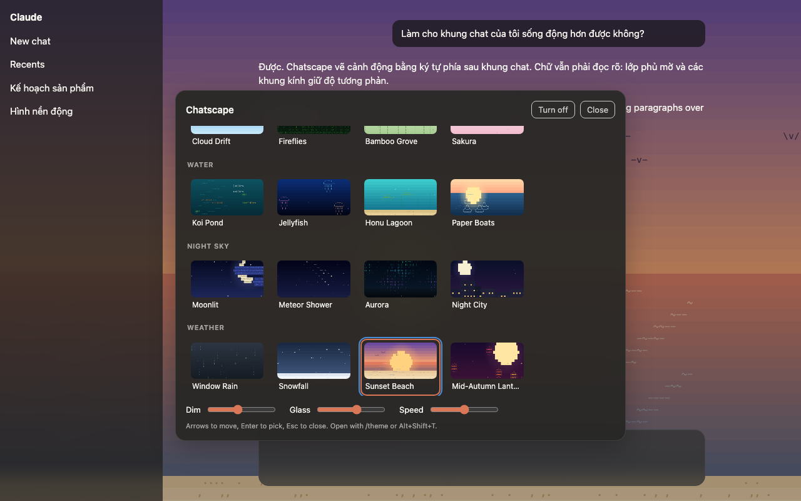

# Chatscape

Live ASCII and pixel wallpapers behind your [claude.ai](https://claude.ai) and [ChatGPT](https://chatgpt.com) chat. 20 animated scenes, picked in two clicks, no account, nothing leaves your browser.

[Website and live demo](https://chatscape.openyard.cloud) · [Privacy policy](https://chatscape.openyard.cloud/privacy) · Part of [OpenYard](https://openyard.cloud)



Chatscape is an independent open-source project. It is not affiliated with or endorsed by Anthropic.

## Install (developer mode, until the store listing is live)

1. Download [chatscape.zip](https://chatscape.openyard.cloud/download/chatscape.zip) from [chatscape.openyard.cloud](https://chatscape.openyard.cloud) and unzip it, or clone this repository.
2. Open `chrome://extensions` (Edge: `edge://extensions`, Brave: `brave://extensions`) and turn on **Developer mode**.
3. Click **Load unpacked** and pick the `chatscape` folder.
4. Open or reload claude.ai or chatgpt.com. The default scene, Cloud Drift, appears behind the chat.

## Use

- Open the picker: click the Chatscape toolbar button, press **Alt+Shift+T** (**⌥ Option+Shift+T** on a Mac), or type `/theme` in the chat box and press Enter (the message is not sent).
- Arrow keys move through the themes and apply them live; Esc closes the picker.
- **Dim** lays a veil in the page's own colour over the scene so text stays readable. **Glass** sets how see-through the sidebar, composer and menus are. **Speed** 0 freezes the scene.
- **Turn off** restores the page exactly as it was.

Your choice syncs across your Chrome profiles through `chrome.storage.sync`.

## Themes

| Group | Themes |
| --- | --- |
| Nature | Cloud Drift, Fireflies, Bamboo Grove, Sakura |
| Water | Koi Pond, Jellyfish, Honu Lagoon, Paper Boats |
| Night sky | Moonlit, Meteor Shower, Aurora, Night City |
| Weather | Window Rain, Snowfall, Sunset Beach, Mid-Autumn Lanterns |
| Tech | Code Rain, Neon Rain, Game of Life, Retro 8-bit |

## Privacy

- The only permission is `storage`, and the content script runs only on `https://claude.ai/*` and `https://chatgpt.com/*`.
- No network requests, no analytics, no remote code.
- The scanner reads computed background colours and sizes, never text. The only text read is the composer's, at the moment you press Enter, to check whether it is exactly `/theme`.

## Add a theme

A theme is data in [`src/themes.js`](src/themes.js): a list of layers painted in order on a grid of character cells. No drawing code is needed.

```js
{
  id: 'my-theme',
  name: 'My Theme',
  group: 'Nature',
  dark: true,
  layers: [
    { type: 'gradient', from: 0x060a22, to: 0x1c2555 },
    { type: 'stars', density: 0.03, glyphs: '.·*', from: 0x2a3060, to: 0xffffff },
    { type: 'particles', density: 6, glyphs: ['*', '.'], colors: [0xffffff], vy: 2, wobble: 1 },
  ],
}
```

Layer types (their options are documented above each painter in [`src/engine.js`](src/engine.js)): `gradient`, `stars`, `clouds`, `disc`, `waves`, `particles`, `sprites`, `grass`, `stalks`, `ground`, `columns`, `meteors`, `aurora`, `skyline`, `life`. Vertical bounds `y0` / `y1` are fractions of the screen height; colours are `0xRRGGBB` numbers.

To check your theme, open `test/gallery.html` (every theme side by side) or `test/index.html?theme=my-theme&mode=dark` (a stand-in for the claude.ai layout) in your browser.

## How it works

```
src/engine.js   grid of cells, layer painters, canvas renderer
src/themes.js   the theme library (data only)
src/scanner.js  makes the chat page's opaque backgrounds transparent or frosted
src/picker.js   in-page picker (shadow DOM)
src/main.js     settings, animation loop, shortcuts
src/page.css    page rules, all scoped to html[data-chatscape]
background.js   toolbar button and keyboard command
site/           chatscape.openyard.cloud (uses src/engine.js for its live background)
store/          Chrome Web Store listing text and artwork
scripts/build.sh  builds dist/chatscape-<version>.zip and the site
```

To release: bump `version` in `manifest.json`, run `npm run deploy` (builds the zip and publishes the site), then upload `dist/chatscape-<version>.zip` in the Chrome Web Store dashboard using `store/listing.md`.

The canvas sits behind the page at `z-index: -1`. The scanner finds opaque backgrounds by computed style instead of class names, so it survives most claude.ai and ChatGPT redesigns. Rendering runs at up to 30 frames per second, pauses when the tab is hidden, and draws a single still frame when the system asks for reduced motion.

## Credits

Inspired by [Pixel Chat Themes](https://github.com/Aqua2409z/pixel-chat-themes) (MIT), whose idea of reading computed styles to find the page's backgrounds this project follows. Chatscape's code is written independently.

## Tiếng Việt

Chatscape đặt hình nền động vẽ bằng ký tự phía sau khung chat claude.ai và ChatGPT. Có 20 cảnh, không cần tài khoản, không gửi dữ liệu đi đâu. Tải [chatscape.zip](https://chatscape.openyard.cloud/download/chatscape.zip) rồi giải nén. Cài đặt: mở `chrome://extensions`, bật **Developer mode**, bấm **Load unpacked** và chọn thư mục `chatscape`. Đổi cảnh bằng nút trên thanh công cụ, phím **Alt+Shift+T**, hoặc gõ `/theme` rồi Enter trong ô chat.

## License

[MIT](LICENSE)
